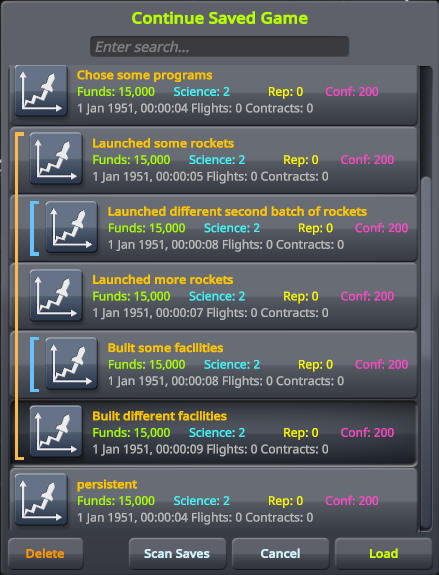

# Save Timelines

A Kerbal Space Program mod that shows saved games as a tree of timelines in the in-game load dialog, in place of one flat alphabetical list.

Saves made one after another appear as a group. When you load an earlier save and save again, you have forked the timeline: the branch you played most recently stays in line, and the other branch is nested under the save where they split. The newest save is always at the top level, along with every save it descends from.

The screenshot above represents these forked timelines:

1. Chose some programs - persistent (the currently active timeline)
2. Chose some programs - Launched some rockets - Launched more rockets - Built some facilities
3. Chose some programs - Launched some rockets - Launched more rockets - Built different facilities
4. Chose some programs - Launched some rockets - Launched different second batch of rockets

## Using it

Open the load dialog from the Space Center or flight pause menu, or with Mod+F9.

- Click a group line to collapse its group to its first save.
- Searching shows every matching save, including those inside collapsed groups.
- Saves made before the mod was installed have no recorded history and are listed after the trees. Press **Scan Saves** to read them and place each under its most likely parent. Saves placed this way are marked *inferred*.

## How it knows

From the moment it is installed, the mod records which save each new save came from, across loads, quickloads, and reverts. That record is exact.

A scan compares what each save contains: finished contracts, unlocked technology, vessels in flight and their launch times, active strategies, and, with RP-1, launch records, programs, leaders, and construction and integration progress. A save is placed under the save with the most history that is entirely contained in its own. Two saves with nothing to tell them apart can be placed in the wrong order.

## Files it creates

Each save folder gets a `SaveTimelines.cfg` holding the recorded history and which groups are collapsed, and after a scan a `SaveTimelines.scan` cache. Save files themselves are never modified. Deleting both files resets that folder; the scan cache alone can be deleted at any time.

## Installing

Install with [CKAN](https://github.com/KSP-CKAN/CKAN), or download the latest zip from [releases](https://github.com/sparr/ksp-mod-SaveTimelines/releases) and copy `GameData/SaveTimelines` into your KSP `GameData` folder.

Requires KSP 1.12 and [HarmonyKSP](https://github.com/KSPModdingLibs/HarmonyKSP).

## Building

You need the [.NET SDK](https://dotnet.microsoft.com/download) (8 or later) and a KSP 1.12 install with HarmonyKSP.

1. Copy `SaveTimelines.props.user.example` to `SaveTimelines.props.user` and set the path to your KSP install. Alternatively, set the `KSP_ROOT` environment variable.
2. Run `dotnet build`.

The plugin is written to `GameData/SaveTimelines/Plugins/`. Run `./install.sh` to copy the mod folder into the KSP install.

## License

MIT. See `LICENSE`.
